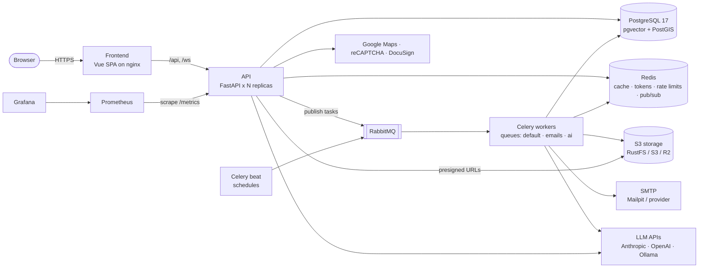
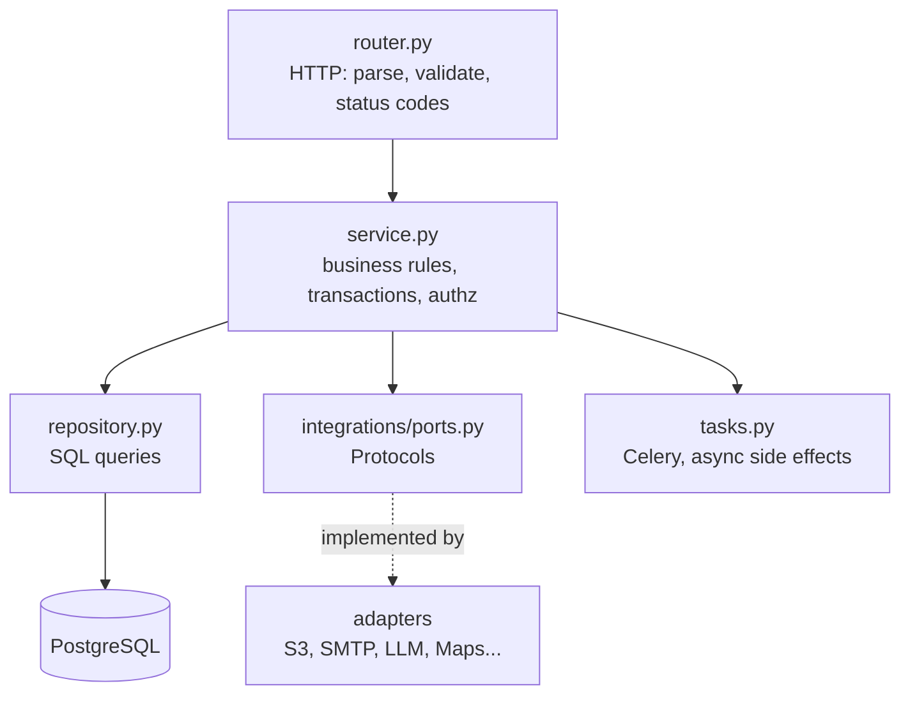
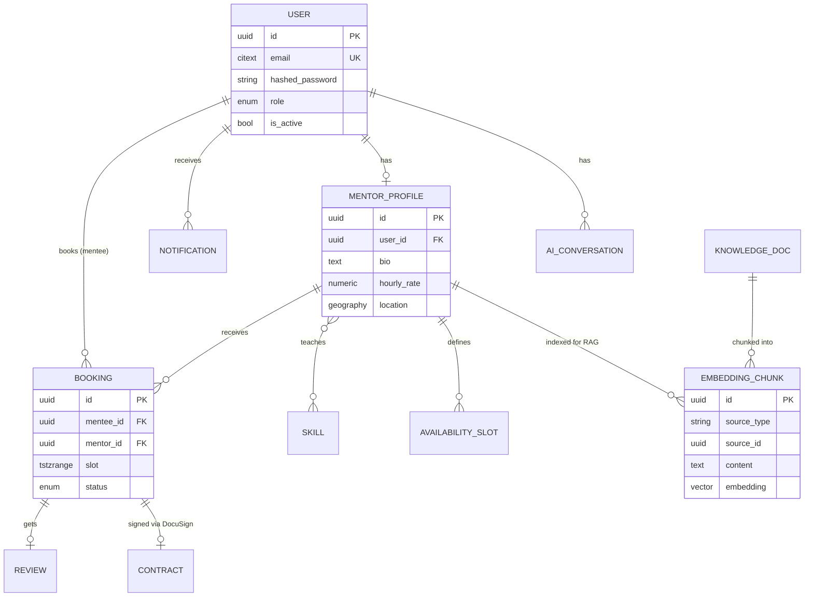

# Architecture

MentorHub is a **modular monolith**: one deployable API split into feature modules with
strict boundaries, plus background workers that share the same codebase. This keeps
operations simple (one service to deploy, one DB) while leaving a clean seam to extract a
module into its own service later if it ever needs to scale independently
(see [ADR-0001](adr/0001-modular-monolith.md)).

## Containers

## Backend layers

Dependencies point **inward**: routers know services, services know repositories and
ports, nothing below knows about HTTP. That makes services unit-testable with fakes and
lets adapters be swapped (e.g. reCAPTCHA → Turnstile) without touching business code.

## Data model (draft — evolves per phase)

## Cross-cutting concerns

| Concern | Where | Approach |
|---|---|---|
| Config | `core/config.py` | Typed `Settings` from env vars; refuses insecure defaults in prod |
| Errors | `core/exceptions.py` | Domain `AppError` → RFC 9457 Problem Details |
| Logging | `core/logging.py`, `core/middleware.py` | structlog, JSON in containers, `request_id` on every line |
| Metrics | `main.py` | Prometheus instrumentator: RPS, latency histograms, status classes |
| Health | `api/health.py` | `/health/live` (process) vs `/health/ready` (dependencies) |
| Pagination | `core/pagination.py` | Offset `Page[T]` for catalogs, keyset `CursorPage[T]` for feeds |
| Auth | `modules/auth` (Phase 1) | Short-lived JWT access + rotating refresh in Redis, RBAC dependencies |
| Caching | services (Phase 2) | Cache-aside in Redis, versioned keys, explicit invalidation |
| Background work | `worker/` | Celery, acks-late, idempotent tasks, separate queues by latency class |
| Real-time | `modules/notifications` (Phase 3) | WebSocket + Redis pub/sub fan-out, polling fallback |
| AI | `modules/ai` + ports (Phase 5) | Provider-agnostic LLM port, pgvector RAG, evals |

## Decisions

See [adr/](adr/) — each significant choice is recorded with context, alternatives and
consequences. They double as material for the thesis' design chapter.
